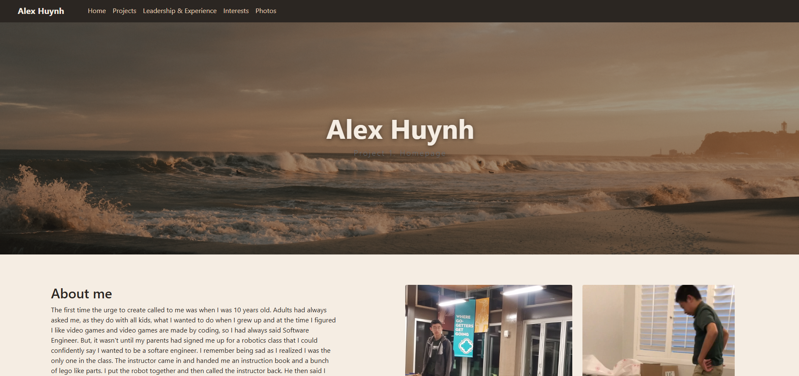
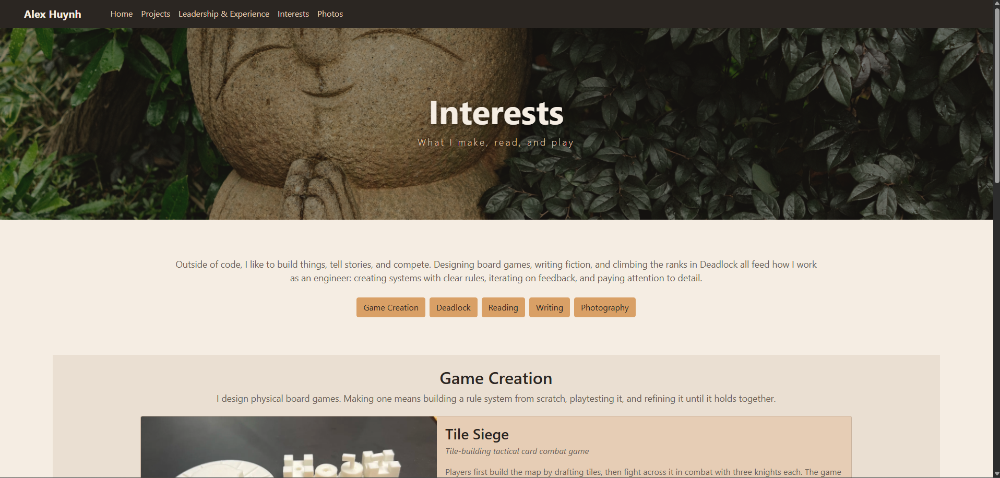
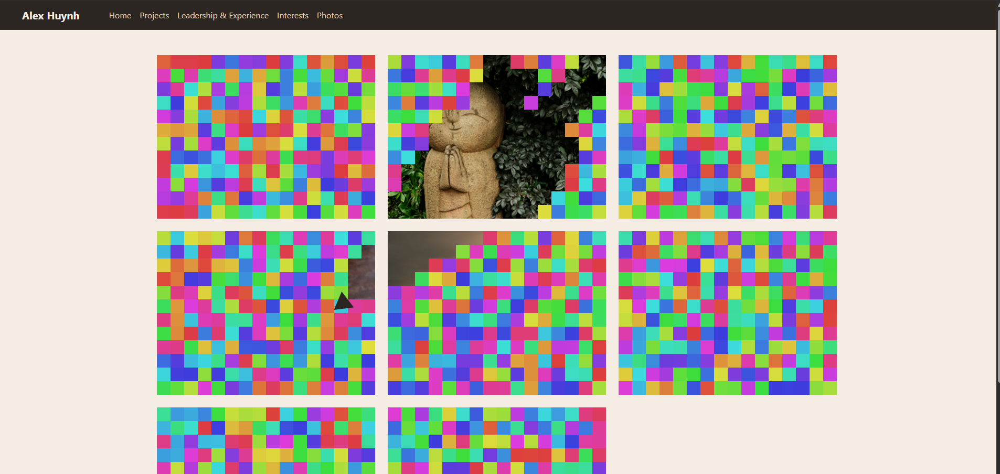

# Alex Huynh Homepage
 
A personal portfolio website that introduces me to potential software engineering employers. It showcases my background, projects, leadership and experience, interests, and the results of my interests.
 
## Project Objective
 
Present my skills and experience clearly and professionally in a multi-page, responsive site. The site highlights:
 
- **Home:** about me, coding skills, courses, projects, and leadership and experience
- **Interests:** game creation, Deadlock, reading, writing, and photography
- **Photos:** a photography gallery as well as an interesting javascript implementation to showcase my skills

## Site Screenshots





## Requirements

- Any modern web browser(Chrome, Firefox, etc.)
- An internet connection

## How to Use
 
1. Clone this repository:
```bash
   git clone https://github.com/AlexDHuynh27/AlexDHuynh27.github.io.git
   cd AlexDHuynh27.github.io.git
```
2. Open `index.html` in your web browser.
 
Or visit [AlexDHuynh27.github.io](https://AlexDHuynh27.github.io)
## Author
 
[Alex Huynh](https://AlexDHuynh27.github.io)
 
## Class
 
Created for [CS5610](https://northeastern.instructure.com/courses/261032)
 
## Video Demonstration
 
[Watch the demo](https://youtu.be/PyyCBE7EA88)

## AI Usage
Antropics Opus 5.5 Model was used to generate the interests page.
Prompt 1:
(Given index.html, index.css as photos.html styling doesn't exactly match with the overall website due to the mini game.)
Following the style in this page, create a page for my interests with html css and bootstrap which include: Writing, Reading, Photography, Game Creation, and Deadlock. Before creating the page, ask me some questions that may be needed to create the page and make sure I agree with the implementation before providing the code. To make sure I agree give me a plan of what you will implement. Keep in mind that the intended purpose of this page is to showcase myself to potential software engineer employers.

Prompt 2:
Writing: I write fiction. For now have a link to another page for writing excerpts.
Reading: For currently reading have The Way of Kings by brandon sanderson.
Game Creation: I have a physical board games that I have made.
Photography: link to my photography page. photos.html. 
Deadlock: Top 100 on Yamato and Abrams pre-mm. Keep it short. 

Prompt 3:
Keep the same color scheme. Keep variables for colors so that they can be changed later. Have the section laid out as a single scrolling page. 
What is a lightbox?
have extra styles in interests.css

Again, don't implement yet.

Prompt 4:
Board Games: Tile Siege. Tile building tactile card combat game. In the game you first build the map by drafting tiles and then you have combat with three knights. Link to a pdf of the game rules.
Deadlock: Just say Top 100 on Yamato and Abrams before July 30th.
Banner image: use a different photo, leave the actual photo blank for now, I'll figure it out later.
Reading: Have the currently reading. Also have small favorites: Red Rising, Shadow Slave, Giovannis room.

The same model was used to generate a color palette.

Prompt:
Generate a color palette for a website that matches this image.
